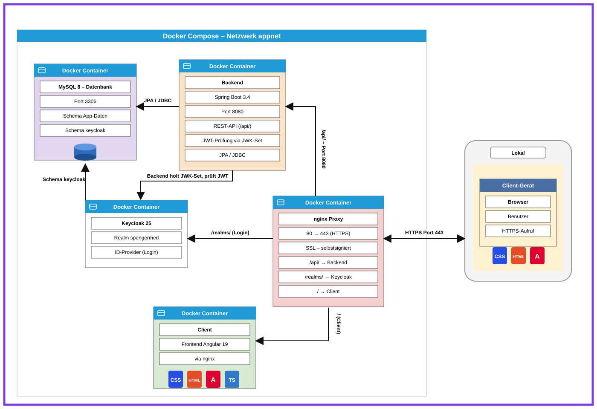

# SpengerFHIRmed

Webanwendung zum Verwalten medizinischer Daten nach dem FHIR-Standard: Spring-Boot-REST-API mit Angular-Client, Login über Keycloak und Start per Docker Compose.


## Kontext

- HTL Spengergasse, 4.–5. Klasse, Fachbereich Medizininformatik
- Einzelprojekt, Dauer ca. 1,5 Jahre
- Entstanden im Unterricht, schrittweise um neue FHIR-Ressourcen erweitert

## Mein Beitrag

Alles allein im Zuge des Unterrichtes umgesetzt:

- Datenmodell: FHIR-Ressourcen (Patient, Practitioner, Organization, Encounter, Observation, Medication, ManufacturedItemDefinition, Substance, CodeSystem) als JPA-Entities mit eingebetteten Typen (Identifier, HumanName, Coding, Quantity …)
- REST-API (`/api/...`) mit Controllern, Services und Repositories inkl. CRUD
- Suchfunktionen über JPA Specifications (z. B. Patient, Practitioner, Medication, CodeSystem)
- Eigener Validator für Sozialversicherungsnummern (`SVNRValidator`)
- Absicherung der API per JWT (Keycloak) mit Rollen-Mapping
- Angular-Client mit Listen- und Detailansichten und Keycloak-Login
- Docker-Setup (Backend, Frontend, MySQL, Keycloak, nginx-Reverse-Proxy mit HTTPS)
- Unit-/Integrationstests für Controller und Repositories

## Technologien

- **Backend:** Java 21, Spring Boot 3.4.4 (Web, Data JPA, Validation, Security, OAuth2 Resource Server, Actuator), Lombok, springdoc-openapi (Swagger UI)
- **Datenbank:** MySQL 8 (Docker), H2 (Profil `h2`, lokal/Tests)
- **Frontend:** Angular 19, TypeScript, Bootstrap 5, keycloak-angular
- **Auth:** Keycloak 25 (Realm `spengermed`)



- **Infrastruktur:** Docker Compose, nginx, Maven

## Funktionen

- Anlegen, Anzeigen, Ändern und Löschen von FHIR-Ressourcen über REST
- Suche mit Filterparametern
- Listen- und Detailansichten im Browser (Patienten, Behandler, Encounter, Medikation, Beobachtungen, Herstellungsartikel)
- Login über Keycloak (PKCE), geschützte Routen im Client
- Swagger UI für die API-Dokumentation
- Testdaten über `import.sql`

## Installation & Start

**Variante A – Gesamtsystem mit Docker** (Docker und Docker Compose nötig):

```bash
docker-compose up --build
```

Danach über `https://localhost` erreichbar (selbstsigniertes Zertifikat, Browser-Warnung bestätigen). Der Keycloak-Realm wird aus `keycloak/realm-export.json` importiert. Der Start von Keycloak kann einige Minuten dauern.

**Variante B – nur Backend lokal mit H2** (JDK 21 nötig):

```bash
cd backend/spring-boot
./mvnw spring-boot:run -Dspring-boot.run.profiles=h2
```

Die API läuft dann auf Port 8080, Tests mit `./mvnw test`.

**Frontend einzeln** (Node.js nötig; `proxy.conf.json` liegt vor, der Keycloak-Login erwartet laut Code `https://localhost`):

```bash
cd frontend/client_falsch
npm ci
npm start
```


## Was ich gelernt habe

- Aufbau einer geschichteten Spring-Boot-Anwendung (Entity, Repository, Service, Controller)
- Abbildung des FHIR-Standards in JPA-Entities und Umgang mit verschachtelten Typen
- Dynamische Suche mit JPA Specifications
- Absichern einer REST-API mit OAuth2/JWT und Keycloak
- Angular-Komponenten, Routing, Guards und HTTP-Anbindung an eine API
- Containerisierung mit Docker Compose, Reverse Proxy und HTTPS

## Bekannte Einschränkungen 

- Zugangsdaten (DB-Passwort, Keycloak-Admin, Client-Secret, Keystore, Zertifikat samt privatem Schlüssel) sind im Repository hinterlegt. Nur für Demo/Schule geeignet, produktiv gehören sie in Umgebungsvariablen bzw. Secrets.


